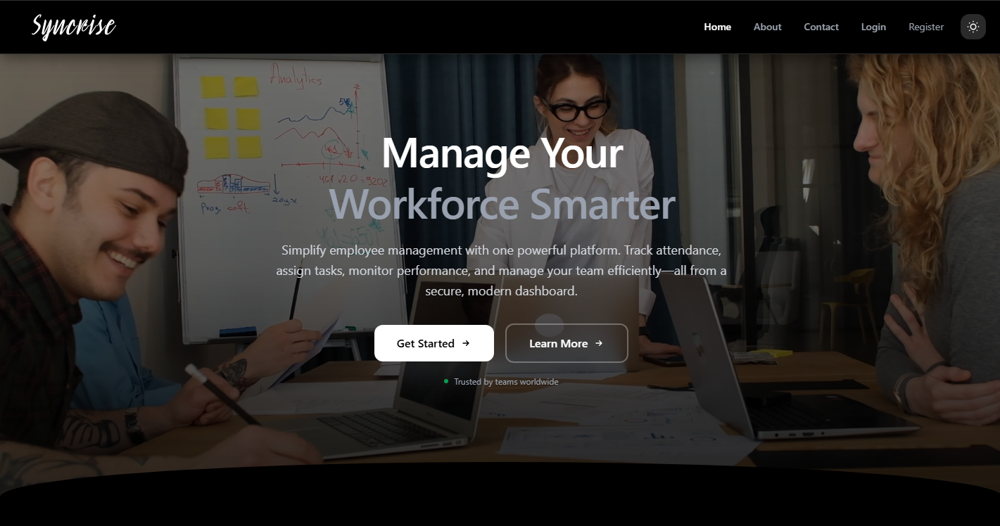

# 👥 Syncrise 🔒

> **Private Source Code** · Syncrise was developed during my Full Stack Developer Internship at Oceaniek Technologies India. The production source code is private. This repository provides a technical overview, architecture, features, and my contributions to the project.

🌐 **Live Application:** https://syncrise.vercel.app

---

## 📌 Overview


**Syncrise** is a workforce management platform designed to help organizations manage employees, departments, tasks, attendance, and administrative workflows from a centralized dashboard.

The platform was developed as part of a **2-developer team** during my Full Stack Developer Internship at **Oceaniek Technologies India, Mohali**, and was used by **40+ active users**.

The system uses role-based access control to provide different capabilities to:

- 👤 Users
- 👨‍💼 Managers
- 🛡️ Super Admins

---

# ✨ Key Features

### 🔐 Authentication & Account Management

- Email/password authentication
- Email verification
- Password reset
- Session management
- Protected routes
- Secure authorization workflows

### 👥 Role-Based Access Control

The application implements three primary roles:

```text
                    ┌───────────────┐
                    │  Super Admin  │
                    └───────┬───────┘
                            │
                    ┌───────▼───────┐
                    │    Manager    │
                    └───────┬───────┘
                            │
                    ┌───────▼───────┐
                    │     User      │
                    └───────────────┘
